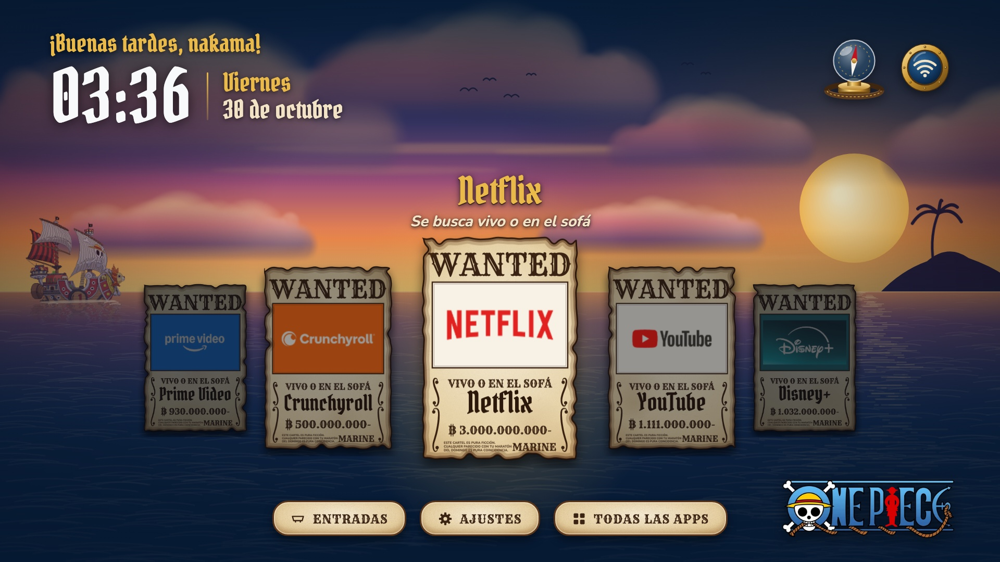
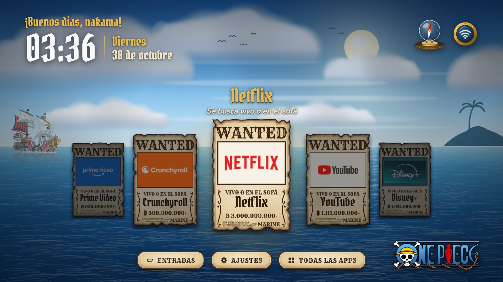
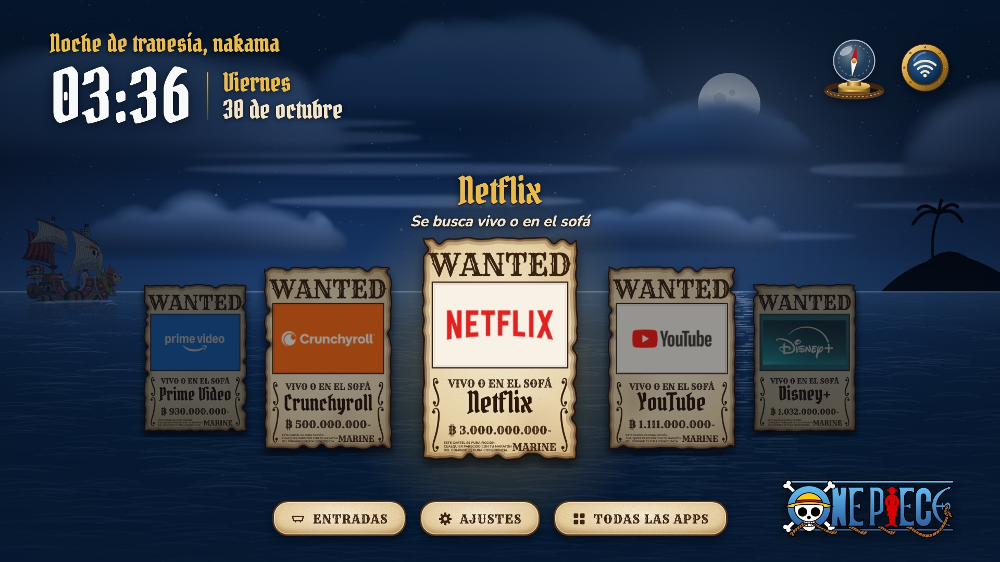
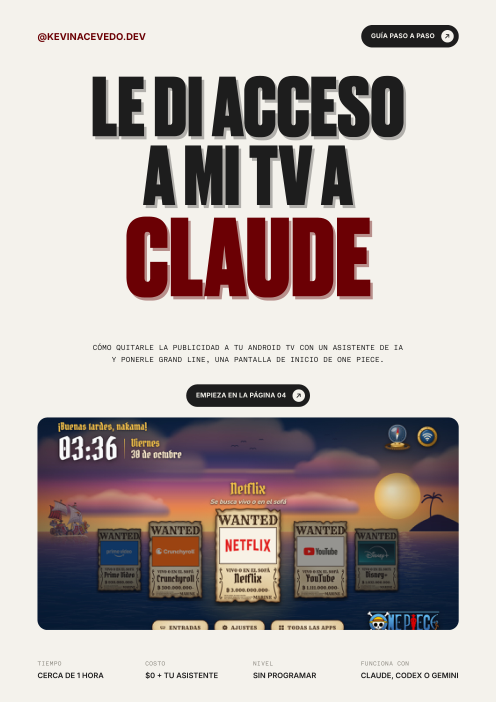
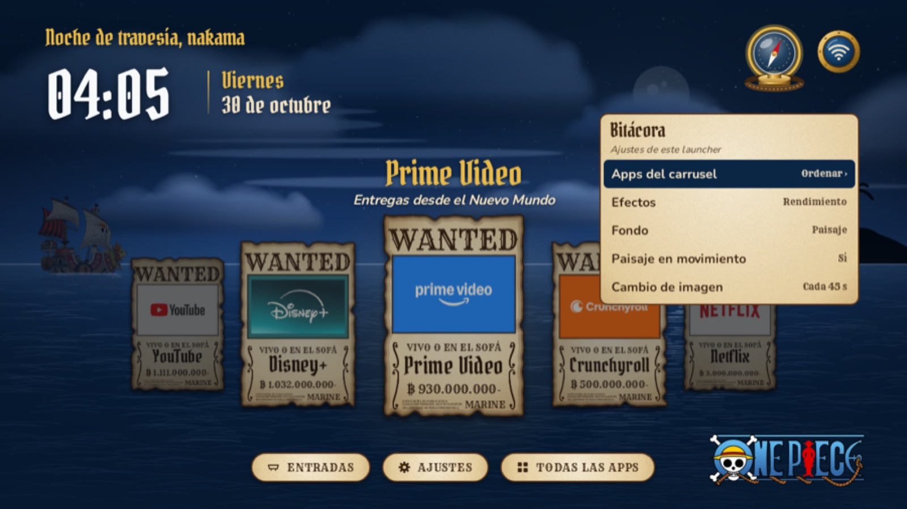
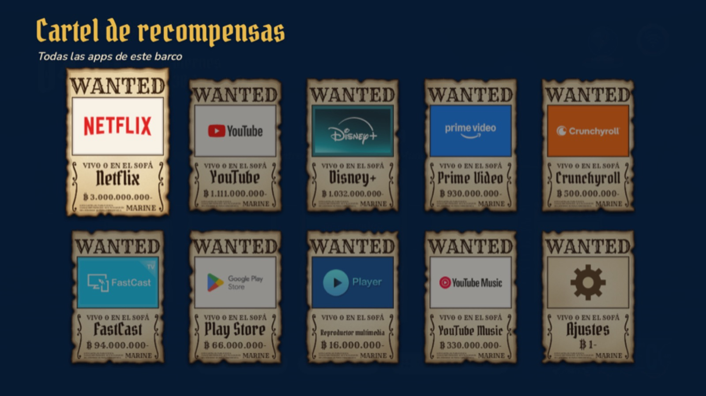

# Grand Line 🏴‍☠️ · Launcher de One Piece para tu TV

Le di acceso a mi TV a Claude: le quitó la publicidad y el bloatware y después le puso una pantalla de inicio de One Piece. Cada app es un cartel de **Se Busca**, la brújula Log Pose busca islas y el Thousand Sunny navega al fondo. Además, el paisaje cambia con la hora del día.

Aquí tienes todo para hacerle lo mismo a tu TV. **No hay que descargar ni clonar nada**: le pasas dos links a tu asistente de IA y él hace el resto.



| Mañana | Tarde | Noche |
|---|---|---|
|  |  |  |

---

## Qué necesitas

- **Un TV con Android TV o Google TV**, o un TV box / Chromecast con Google TV (Xiaomi, TCL, Hisense, Sony, Kalley, Philips, Nvidia Shield…).
  - No funciona en Samsung, LG, Roku ni Fire TV. Para esos, mira [cleanyour.tv/not-android](https://cleanyour.tv/not-android).
- **Un computador** (Mac, Windows o Linux) **en la misma Wi-Fi que el TV**.
- **Un asistente de IA de terminal**: [Claude Code](https://claude.com/claude-code) (el que usé yo), [Codex](https://github.com/openai/codex) o [Gemini CLI](https://github.com/google-gemini/gemini-cli).
- **Cerca de una hora**, con el TV encendido y de una sola sentada.

---

## Paso a paso

### 1. Activa el modo desarrollador en el TV · 2 min

Ve a **Ajustes › Sistema › Información** (o *Preferencias del dispositivo › Información*). Baja hasta **Compilación del SO** y presiona **OK 7 veces seguidas**, hasta que diga *«Ya eres desarrollador»*.

### 2. Enciende la depuración · 2 min

Vuelve atrás y entra en **Opciones para desarrolladores**. Activa **Depuración USB** y también **Depuración inalámbrica** o **Depuración por red** si tu TV la muestra.

### 3. Instala tu asistente y ábrelo en una carpeta vacía · 10 min

Escoge uno y pega su comando en la Terminal (Mac) o en PowerShell (Windows):

```bash
# Claude Code (Mac / Linux)
curl -fsSL https://claude.ai/install.sh | bash

# Claude Code (Windows)
irm https://claude.ai/install.ps1 | iex

# Codex
npm install -g @openai/codex

# Gemini CLI
npm install -g @google/gemini-cli
```

Después crea una carpeta y abre el asistente ahí:

```bash
mkdir grand-line && cd grand-line
claude
```

### 4. Limpia el TV · 20–25 min

Escríbele esto al asistente:

```text
Lee https://github.com/Gathin23/cleanyourtv/blob/main/PROMPT.md y síguelo paso a paso. Mi TV es [marca y modelo].
```

El asistente se trae solo el repo [CleanYourTV](https://github.com/Gathin23/cleanyourtv). Luego:

1. Se conecta al TV. Acepta en el TV el aviso de depuración.
2. Hace un backup y deja listo cómo restaurarlo.
3. Te pregunta qué apps usas.
4. Desactiva la publicidad y la telemetría. No desinstala nada.

### 5. Ponle Grand Line · 30–40 min

En la misma conversación, escríbele:

```text
Lee https://github.com/kevinAcevedo240/grand-line-tv/blob/main/PROMPT-GRAND-LINE.md y síguelo.
```

El asistente descarga el logo y el Sunny de este repo y te hace unas preguntas: tu saludo, tus apps, el idioma y el nivel de efectos. Después te muestra un **prototipo en el navegador**. Cuando lo apruebas, lo compila y lo instala en el TV.

> 💡 Si tu TV tiene 2 GB de RAM o menos, escoge efectos en **rendimiento**.

### 6. Apaga la depuración · 1 min

Al terminar, el asistente te pide apagar la depuración. Hazlo en **Opciones para desarrolladores**. El launcher sigue funcionando igual.

---

## Qué hay en este repo

| Archivo | Qué es |
|---|---|
| [`PROMPT-GRAND-LINE.md`](PROMPT-GRAND-LINE.md) | El prompt completo del launcher: diseño, carteles, brújula, paisaje, animaciones y rendimiento. |
| [`imagenes/`](imagenes) | Las únicas dos imágenes que usa: el logo de One Piece y el Thousand Sunny, con fondo transparente. Todo lo demás se dibuja con código. |
| [`Guia-Grand-Line.pdf`](Guia-Grand-Line.pdf) | La guía visual completa, con fotos de cada paso. |
| [`capturas/`](capturas) | Capturas del launcher en mi TV. |

<a href="Guia-Grand-Line.pdf"></a>

## Después de instalarlo

Sube a la brújula de arriba a la derecha y presiona **OK** para abrir la **Bitácora**. Desde ahí puedes cambiar los efectos, el fondo y el movimiento del paisaje sin computador.

Para cualquier otro cambio, vuelve a encender la depuración, abre el asistente en la misma carpeta y pídeselo con tus palabras. Por ejemplo: *«Pon Crunchyroll de primera»* o *«Que me diga capitán en vez de nakama»*.

| Bitácora | Todas las apps |
|---|---|
|  |  |

---

Si lo haces, etiquétame: **[@kevinacevedo.dev](https://www.tiktok.com/@kevinacevedo.dev)** en TikTok e Instagram. Quiero verlo 🙌

**Créditos.** [CleanYourTV](https://github.com/Gathin23/cleanyourtv) es un proyecto de código abierto de Gathin23; si te sirvió, dale una estrella. One Piece © Eiichiro Oda / Shueisha / Toei Animation. Grand Line es un proyecto de fan, para uso personal y sin fines comerciales.
